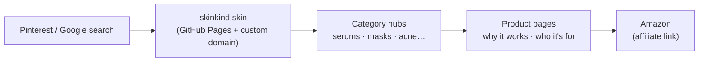

<div align="center">


**A hand-built skincare discovery site, live on its own domain, with an affiliate business model.**

[](https://skinkind.skin)


</div>

---

## ✦ The idea

Skincare shopping online is overwhelming: a thousand serums, the same five sponsored listings, and no one telling you *which one fits your skin and your budget*.

**SkinKind** is my answer: a calm, editorial-style site that groups products by what you actually need (acne-prone skin, a budget routine, natural ingredients, body care) and links straight to the product. It's live on its own domain and monetised through the Amazon Associates programme.

> I treated this like a small product, not a class project: custom domain, legal pages, SEO metadata and a design system. Then I kept shipping pages.

## ✦ At a glance

| | |
|---|---|
| **Live site** | [skinkind.skin](https://skinkind.skin) |
| **Pages** | 35 hand-written HTML pages: category hubs, product reviews and curated lists |
| **Categories** | Natural · Body care · Serums · Sheet masks · Shampoo & conditioner · Acne & sensitive |
| **Business model** | Amazon Associates affiliate links, with a public [disclosure](https://skinkind.skin/disclosure.html) and [privacy policy](https://skinkind.skin/privacy.html) |
| **Stack** | Plain HTML + one shared stylesheet (~1,100 lines). No framework, no build step. |

## ✦ Design choices

- **Editorial, not e-commerce.** Serif display type (*Playfair Display*, *Cormorant Garamond*) paired with *Montserrat* / *Inter* for body text, so it reads like a beauty magazine rather than a store.
- **One accent colour.** A muted gold `#C9A27C` on warm off-whites (`#FAF7F5`, `#FFFAF0`) carries the brand across every page.
- **One stylesheet for everything.** All 35 pages share `style.css`, so the look stays consistent and the site loads fast.
- **Responsive.** Breakpoints at 992 px, 900 px and 768 px, because people browsing skincare on Pinterest are mostly on their phones.
- **Search-ready.** Each product page has its own `<title>` and meta description written for search.
- **Trust first.** Every affiliate link is covered by a clear disclosure page, as Amazon's programme requires.

## ✦ How it's built



## ✦ Project structure

```
Skinkind/
├── index.html              # home: hero + category grid
├── style.css               # the single shared design system
├── <category>.html         # serums, sheet-masks, shampoo, body-care, natural-skincare, acne&sensitive…
├── <product>.html          # cetaphil, centellaserum, khadi, plum, sebamed…
├── disclosure.html         # Amazon Associates disclosure
├── privacy.html            # privacy policy
├── images/                 # product & category photography
└── CNAME                   # custom domain → skinkind.skin
```

## ✦ Run it locally

No install needed. It's a static site.

```bash
git clone https://github.com/Stanvi09/Skinkind.git
cd Skinkind
python -m http.server 8000      # then open http://localhost:8000
```

## ✦ What I learned

- **Shipping is a skill.** Buying a domain, wiring DNS to GitHub Pages and getting accepted into an affiliate programme taught me more than any tutorial.
- **Content is the product.** Clean code doesn't matter if the recommendations aren't useful, so every page answers *"who is this for?"*
- **Constraints help.** Skipping frameworks kept me focused on layout, typography and responsive CSS.

## ✦ What's next

- [ ] Move to a static-site generator (Eleventy / Astro) so product pages come from one template + data file
- [ ] Optimise images (WebP + `loading="lazy"`)
- [ ] A "build my routine" quiz that recommends a 3-step routine by skin type

---

<div align="center">

Designed, written and shipped by **Tanvi Sadashiv**
<br/>
<a href="https://www.linkedin.com/in/tanvi-sadashiv-3713ba381"></a>
<a href="https://github.com/Stanvi09"></a>

<sub>Product links on the live site are affiliate links. SkinKind may earn a small commission at no extra cost to you.</sub>


</div>
