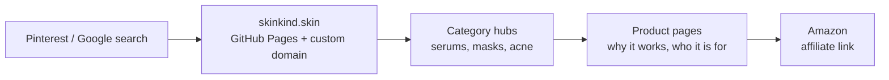
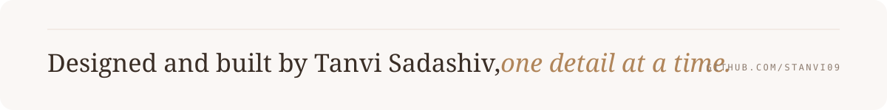

<picture>
  <source media="(prefers-color-scheme: dark)" srcset=".github/assets/header-dark.svg">
  
</picture>

<p align="center"><a href="https://skinkind.skin"><b>Visit skinkind.skin</b></a></p>

<picture>
  <source media="(prefers-color-scheme: dark)" srcset=".github/assets/stats-dark.svg">
  
</picture>

<br>

## 01 &nbsp; The idea

Skincare shopping online is loud: a thousand serums, the same sponsored listings, and nobody telling you *which one suits your skin and your budget*.

SkinKind is the quiet version. It's an editorial site that groups products by what you need (acne-prone skin, a budget routine, natural ingredients, body care) and says plainly who each product is for. It runs on its own domain and is funded through the Amazon Associates programme.

## 02 &nbsp; How it's built



## 03 &nbsp; Details I obsessed over

- **It reads like a magazine, not a store.** Serif display type (*Playfair Display*, *Cormorant Garamond*) over clean sans body text (*Montserrat*, *Inter*).
- **One accent colour.** A muted gold, `#C9A27C`, on warm off-whites. Nothing else competes with it.
- **One stylesheet.** All 35 pages share a single `style.css`, so every page feels like it came from the same hand.
- **Phone first.** Breakpoints at 992, 900 and 768 px, because skincare browsing happens on Pinterest, on phones.
- **A description for every page.** Each product page has its own title and meta description, written for search.
- **Trust is part of the design.** A clear [affiliate disclosure](https://skinkind.skin/disclosure.html) and [privacy policy](https://skinkind.skin/privacy.html), linked from the navigation.

## 04 &nbsp; Repository map

```
Skinkind/
├── index.html          home: hero and category grid
├── style.css           the shared design system
├── <category>.html     serums, sheet-masks, shampoo, body-care, natural-skincare…
├── <product>.html      one page per product
├── disclosure.html     affiliate disclosure
├── privacy.html        privacy policy
├── images/             product and category photography
└── CNAME               custom domain, skinkind.skin
```

## 05 &nbsp; Run it locally

```bash
git clone https://github.com/Stanvi09/Skinkind.git && cd Skinkind
python -m http.server 8000          # open http://localhost:8000
```

## 06 &nbsp; What it taught me

Shipping is a skill. Buying a domain, pointing DNS at GitHub Pages and joining an affiliate programme taught me more than a tutorial would have. And content is the product: clean code means nothing if the recommendations don't help someone choose.

## 07 &nbsp; Next

- Generate product pages from one template and a data file (Eleventy or Astro)
- WebP images with lazy loading
- A short quiz that builds a three-step routine for your skin type

<br>

<picture>
  <source media="(prefers-color-scheme: dark)" srcset=".github/assets/footer-dark.svg">
  
</picture>

<p align="center"><sub><a href="https://www.linkedin.com/in/tanvi-sadashiv-3713ba381">LinkedIn</a> &nbsp;&middot;&nbsp; <a href="https://github.com/Stanvi09">GitHub</a><br><br><i>Product links on the live site are affiliate links. SkinKind may earn a small commission at no extra cost to you.</i></sub></p>
